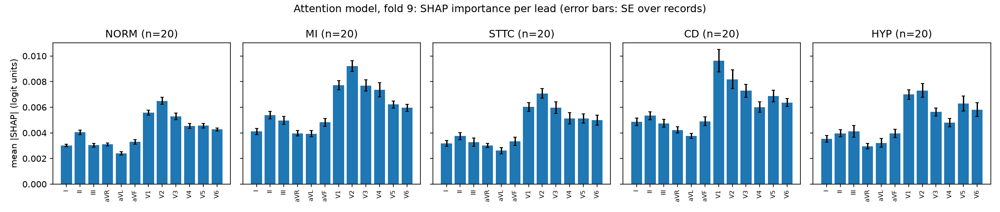

# PrivFedXAI

A privacy-preserving explainable federated learning framework for clinical decision support.
COSC 880 Capstone, Towson University, Fall 2026. Advisor: Dr. Wassila Lalouani.

PTB-XL (12-lead ECG) is the validation dataset. Recording sites are used as simulated hospital clients.
The aim is to train one shared diagnostic model without pooling patient records (federated learning),
limit what the model can reveal about individuals (differential privacy), and show where in the ECG the
model looked (attention heatmaps and SHAP), then measure what each step costs in accuracy. The framework
is written generically; ECG classification is the validation case.

## Status (November 23, 2026)

| Phase | State |
| --- | --- |
| Data pipeline, five site-based clients, classical baselines (LR, SVM, RF) and per-site SMOTE variants | Done |
| Centralized 1D CNN and per-class attention model | Done, weights frozen |
| Federated learning (Flower FedAvg, five clients) | Done, weights frozen |
| Differential privacy (Opacus DP-SGD), epsilon 10, 5 and 1, three repetitions each | Done |
| Fold-10 evaluation (all models scored once, no retuning) | Done |
| Attention-to-ECG alignment (IoU) | Done (fold 9) |
| SHAP lead importance | Done (one chart, fold 9) |
| Streamlit app | In progress, not in this repository yet |
| Final report | Draft |

Final deliverables are due December 1, 2026. Unit tests: 20, all passing (`python -m pytest tests`).

## What has been built

- **Data pipeline:** records are read at 100 Hz, band-pass filtered (0.5-40 Hz, zero-phase), then scaled by one
  fixed constant (0.209 mV). No per-record or per-client statistics are used, so the same preprocessing works
  in federated and DP training.
- **Labels:** multi-label, five diagnostic superclasses (NORM, MI, STTC, CD, HYP). 21,388 of 21,799 records
  have at least one superclass. The model input is the waveform only; age, sex and other metadata are not
  model inputs.
- **Five clients:** recording sites 0, 1, 2, 3 and one pooled "Rest" client (sites 4-50 plus records with no
  site). PTB-XL folds 1-8 are train, fold 9 is validation, fold 10 is test.
- **Classical baselines:** logistic regression, SVM and random forest on 84 hand-crafted features, plus
  per-site SMOTE variants.
- **CNN:** four Conv1d + GroupNorm + ReLU blocks (165,157 parameters). GroupNorm is used instead of BatchNorm
  so the model is compatible with Opacus.
- **Attention model:** the same backbone with per-class additive attention over time in place of mean pooling
  (173,733 parameters). The attention map is over time only and is shared across leads.
- **Federated learning:** five-client FedAvg with Flower, 30 rounds, one local epoch per round.
- **Differential privacy:** Opacus DP-SGD inside the federated clients, delta = 1e-5, epsilon 10, 5 and 1,
  three repetitions each.
- **Explainability:** attention heatmaps, IoU alignment against ECG fiducial points (PTB-XL+), and a SHAP
  lead-importance chart.
- **Evaluation:** per-class and macro AUC, F1 and MCC at a fixed 0.5 threshold, with record-level bootstrap
  confidence intervals, pooled and per client.

## Results

### Fold 10 (test), pooled over the five clients

Macro AUC with a 95% record-level bootstrap interval (1,000 resamples); F1 and MCC at threshold 0.5.
Every model was scored on fold 10 once, with frozen weights.

| Model | Macro AUC [95% CI] | F1 | MCC |
| --- | --- | --- | --- |
| Logistic regression | 0.831 [0.821, 0.842] | 0.615 | 0.470 |
| Random forest | 0.850 [0.840, 0.860] | 0.610 | 0.491 |
| SVM | 0.852 [0.843, 0.862] | 0.633 | 0.496 |
| CNN | 0.925 [0.918, 0.933] | 0.723 | 0.634 |
| CNN + attention | 0.907 [0.899, 0.915] | 0.713 | 0.615 |
| Federated (FedAvg) | 0.919 [0.912, 0.927] | 0.711 | 0.621 |
| Federated + DP, epsilon = 10 | 0.858 [0.848, 0.868] | 0.639 | 0.524 |
| Federated + DP, epsilon = 5 | 0.848 [0.838, 0.858] | 0.623 | 0.503 |
| Federated + DP, epsilon = 1 | 0.812 [0.801, 0.823] | 0.573 | 0.426 |

DP rows are the mean of three repetitions per epsilon. Full tables, per client and per class, are in
`results/fold10/master_table_test.csv`; the SMOTE variants are in the same file.

### Per-class AUC under differential privacy (fold 10, pooled)

| Class | Federated | DP, eps = 10 | DP, eps = 5 | DP, eps = 1 |
| --- | --- | --- | --- | --- |
| NORM | 0.942 | 0.914 | 0.911 | 0.898 |
| MI | 0.907 | 0.820 | 0.807 | 0.773 |
| STTC | 0.933 | 0.904 | 0.900 | 0.855 |
| CD | 0.921 | 0.835 | 0.824 | 0.767 |
| HYP | 0.895 | 0.817 | 0.797 | 0.767 |
| Macro | 0.919 | 0.858 | 0.848 | 0.812 |

At epsilon = 1 the drop from the non-DP federated model is smallest for NORM (-0.045) and STTC (-0.077) and
larger for MI (-0.134), HYP (-0.128) and CD (-0.154). These are point estimates from one fold; we have not
tested whether the differences between classes are significant, and we do not claim a cause.

### Attention alignment (fold 9, attention model, true classes only)

IoU is scored against the reference region of the beat nearest the attention peak. The hit rate is the share of
records whose attention peak lies on a reference region (chance level in brackets).

| Class | Records | IoU [95% CI] | Peak hit (chance) |
| --- | --- | --- | --- |
| MI | 540 | 0.146 [0.141, 0.152] | 0.894 (0.499) |
| STTC | 528 | 0.147 [0.137, 0.157] | 0.678 (0.359) |
| CD | 495 | 0.441 [0.416, 0.466] | 0.913 (0.174) |
| HYP | 268 | 0.012 [0.004, 0.022] | 0.030 (0.166) |

The peak lands on the reference region more often than chance for MI, STTC and CD, but not for HYP. The
reference regions (QRS, ST-T) are our own design choice and have not been reviewed by a clinician. The
attention peak is one or two cells wide while the STTC and MI regions are several cells wide, which caps IoU
well below 1 even for a well-placed peak.

### SHAP lead importance (fold 9, attention model)



The chart shows where the model's output is most sensitive, per lead and class. It mostly follows signal
amplitude (Spearman correlation between the SHAP profile and mean amplitude per lead: 0.82 NORM, 0.84 MI,
0.82 STTC, 0.80 CD, 0.78 HYP). Per unit amplitude, V1 and aVF stand out in all five classes. It is not evidence
of class-specific lead importance. Limits: fold 9 only, 20 records per class, one seed, one background sample.

### How to read these results

- The intervals are unpaired and cover record sampling only (records, not patients). No paired differences
  were computed on fold 10, so do not read small gaps as significant.
- The CNN reads waveforms while the classical baselines read 84 hand-crafted features and are untuned, so that
  comparison mixes representation and model class.
- The attention model scores below the plain CNN (0.907 against 0.925). Its fold-9 AUC peaked early in
  training and then declined; no early stopping was applied. The cause is untested.
- The federated model scores above the centralized attention model. The cause is untested.
- The drop under DP includes gradient clipping and sampling, not only added noise ("DP-SGD as configured").
  There is no clipping-only control.

## Setup

1. Install Anaconda or Miniconda.
2. Create and activate a conda environment:
```bash
conda create -n privfedxai python=3.11
conda activate privfedxai
```
   Install all packages below with pip, not conda.
3. Install PyTorch for your hardware (pip option) from https://pytorch.org/get-started/locally/
4. Install the remaining dependencies:
```bash
python -m pip install -r requirements.txt
```
5. Verify:
```bash
python check_env.py
```

## Dataset

PTB-XL v1.0.3 (PhysioNet): https://physionet.org/content/ptb-xl/1.0.3/
Released under the Creative Commons Attribution 4.0 International license
(https://physionet.org/content/ptb-xl/view-license/1.0.3/).

Please cite the dataset and the original publication: Wagner et al., "PTB-XL, a large publicly available
electrocardiography dataset," Scientific Data 7, 154 (2020), doi:10.1038/s41597-020-0495-6. See the PhysioNet page for the dataset citation and the standard PhysioNet citation.

Download it and place the files in `data/raw/ptbxl/` (the folder that contains `ptbxl_database.csv`).
Raw data and derived files in `data/processed/` are not committed to this repository. The explainability
reference regions use PTB-XL+ fiducial points; see `src/data/extract_ptbxl_plus.py`.

## What is and is not in this repository

- Included: all code, tests, result tables and figures, run logs, and SHA-256 manifests.
- Not included: raw data, the waveform cache, model weights (`*.pt`), and probability and SHAP arrays
  (`results/**/*.npz`). They are git-ignored.
- Because of this, the fold-10 scoring and SHAP scripts cannot run from a fresh clone. They load the frozen
  weights and refuse to run if a file's SHA-256 does not match. Weight hashes are in
  `src/eval/frozen_models.py`; the DP weights' hashes are in `results/fl/DP_MANIFEST.sha256.txt` and the fold-10
  probability hashes in `results/fold10/FOLD10_PROBS.sha256.txt`. To reproduce, retrain; results will differ
  slightly, so compare with the tables above rather than expecting identical hashes.

## Reproducing

Run each command from the repository root, as modules (no `.py`). All development was done on Windows.

Data and baselines:
```bash
python -m src.data.build_features          # 84 baseline features
python -m src.data.build_waveform_cache    # cached waveforms for the CNN
python -m src.models.lr_baseline           # also rf_baseline, svm_baseline
python -m src.models.lr_smote              # also rf_smote, svm_smote
python -m src.eval.make_table              # baseline table on the test fold
```

Centralized models:
```bash
python -m src.models.train                 # CNN (30 epochs, fold 9 monitored)
python -m src.models.train_attn            # CNN + attention
python -m src.eval.compare_val             # models compared on fold 9
```

Federated learning and DP (Flower simulation, five clients). The app lives in `fl_app/`; set `PYTHONPATH` to the
repository root first:
```bash
cd fl_app
flwr run . --stream --federation-config="num-supernodes=5 client-resources-num-cpus=2"
```
The DP sweep (epsilon 10, 5, 1; three repetitions each) is `fl_app/run_dp_sweep.bat`. It is a Windows batch
file with the repository path hard-coded; edit the path before use.

Fold-10 evaluation (needs the frozen weights; the scoring script runs once and refuses to overwrite):
```bash
python -m src.eval.frozen_models           # fold-9 check that the loader reproduces saved results
python -m src.eval.score_fold10            # one pass over fold 10, writes probabilities only
python -m src.eval.table_fold10 --build    # metrics and intervals from the saved probabilities
```

Explainability:
```bash
python -m src.explain.heatmaps             # attention heatmaps (fold 9)
python -m src.explain.iou_run              # IoU alignment, run once
python -m src.eval.shap_select             # fold-9 record selection (labels only)
python -m src.eval.shap_run                # SHAP pass (about 5 minutes on CPU)
python -m src.eval.shap_table --build      # lead-importance CSV and chart
python -m src.eval.shap_amplitude          # exploratory amplitude check
```

Tests:
```bash
python -m pytest tests
```

Commit messages and some code comments cite decision IDs (for example D67). These refer to the author's private
decision log and are not needed to use the code.

## Repository structure

```
src/data/        preprocessing, client partitions, features, waveform cache, fiducial extraction
src/models/      classical baselines, SMOTE variants, 1D CNN, attention model, training scripts
src/federated/   local training, per-client and DP fairness tables
src/eval/        metrics, bootstrap intervals, frozen-model loader, fold-10 scoring, SHAP
src/explain/     attention heatmaps and IoU alignment
fl_app/          Flower app (client, server) and the DP sweep runner
tests/           unit tests
sanity/          throwaway library checks
notebooks/       EDA
results/         tables and figures (large arrays and model weights are git-ignored)
```

## Limitations

- Clients are recording sites, which are partly confounded with recording device, so non-IID effects mix label
  and device differences.
- Differential privacy via Opacus protects individual records, not patients (a patient can have up to 10
  records).
- Validation is on one modality (12-lead ECG) and one dataset. We use PTB-XL's fixed patient-disjoint folds, not
  leave-one-out cross-validation.
- Fold-10 intervals are unpaired and record-level.
- The IoU reference regions are our own design choice and have not been reviewed by a clinician; the SHAP chart
  mostly reflects signal amplitude.
- The attention map is over time only; the model supports no per-lead attention claim.
- This is research code for a capstone project. It is not a medical device and must not be used for clinical
  decisions.

## Streamlit app

A five-panel demonstration (data input, prediction, attention heatmap, privacy-budget slider, SHAP chart) is in
progress. The privacy slider will switch between precomputed results at epsilon 10, 5, 1 and no DP; it will not
train anything live.

## License

## License

MIT, see [LICENSE](LICENSE). The files in `fl_app/` that come from the Flower app template remain under their own
Apache-2.0 license (`fl_app/LICENSE`). The PTB-XL dataset is not part of this repository and has its own license
(CC BY 4.0, see the Dataset section).